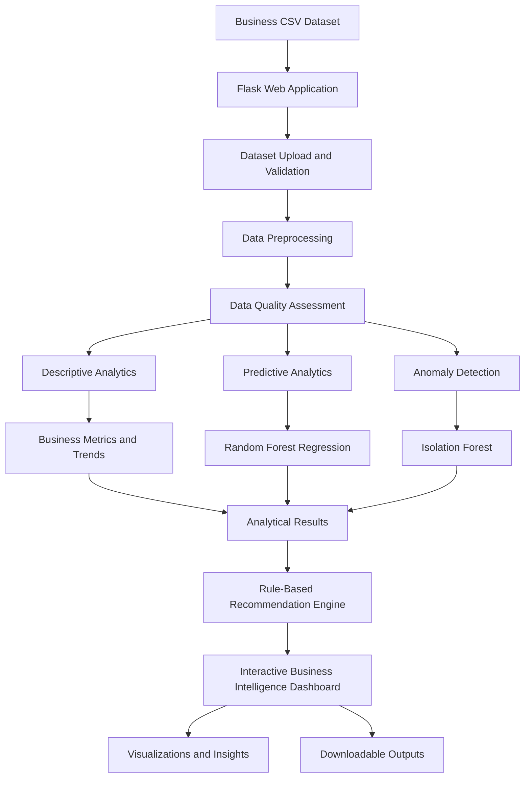
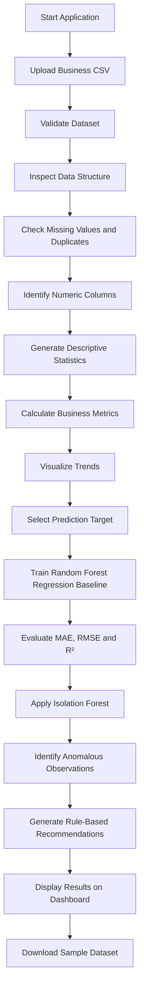

# AI-Powered Business Intelligence and Predictive Analytics System

An interactive Flask-based business intelligence platform that transforms raw business datasets into meaningful insights through descriptive analytics, machine learning-based prediction, anomaly detection, and rule-based decision support.

The system enables users to upload business data, evaluate dataset quality, explore key performance indicators, estimate business outcomes, identify unusual observations, and generate practical recommendations through a centralized web dashboard.

<p align="center">

  **Business Analytics · Machine Learning · Predictive Intelligence · Decision Support**

</p>

---

## Overview

Modern businesses generate large volumes of operational data, but converting that data into actionable decisions requires effective analytical tools.

This project demonstrates an integrated business intelligence workflow that combines data preprocessing, descriptive analytics, predictive modelling, anomaly detection, and recommendation generation within a Flask web application.

Users can upload their own CSV datasets or explore the included sample dataset to understand business performance and discover potentially important patterns.

### Key Highlights

- **Data Analysis:** Upload and explore structured business datasets.
- **Data Quality Assessment:** Identify missing values, duplicate records, and dataset characteristics.
- **Business Intelligence:** Generate numerical summaries, performance indicators, and interactive trend visualizations.
- **Predictive Analytics:** Apply Random Forest Regression as a baseline predictive model.
- **Anomaly Detection:** Use Isolation Forest to identify unusual observations.
- **Decision Support:** Generate practical, rule-based business recommendations.
- **Interactive Dashboard:** Access analytical results through a centralized Flask interface.

---

## System Architecture

The application follows a modular analytical architecture in which uploaded business data passes through preprocessing, analytics, machine learning, and recommendation components before the results are presented through the dashboard.

### 1. Overall System Architecture



### 2. Core System Components

| Component | Technology / Method | Purpose |
|---|---|---|
| Web application | Flask | Handles application routing and dashboard delivery |
| Data ingestion | Pandas | Reads and processes uploaded CSV files |
| Data validation | Pandas | Examines missing values, duplicates, and column structure |
| Descriptive analytics | Pandas, NumPy | Summarizes numerical metrics and business trends |
| Predictive modelling | Random Forest Regressor | Establishes a baseline for numerical outcome prediction |
| Anomaly detection | Isolation Forest | Identifies observations with unusual patterns |
| Recommendation engine | Rule-based logic | Converts analytical findings into practical suggestions |
| Dashboard visualization | HTML, CSS, Chart.js | Presents interactive analytical results |

### 3. End-to-End Analytical Workflow



---

## Key Features

### 1. CSV Dataset Upload and Analysis
- Upload custom business datasets in CSV format.
- Read and process structured business records.
- Automatically identify numeric columns.
- Select a potential prediction target using common business column names.
- Display an overview of the uploaded dataset.

### 2. Data Quality Assessment
- Identify missing values across dataset columns.
- Detect duplicate records.
- Examine dataset dimensions and data types.
- Generate a basic data-quality profile.
- Highlight potential issues that may affect analytical reliability.

### 3. Descriptive Business Analytics
- Generate numerical summaries of business variables.
- Explore sales and other numeric business metrics.
- Analyze trends through interactive charts.
- Present important analytical information through dashboard visualizations.

### 4. Random Forest Predictive Analytics

The application implements a Random Forest Regression baseline to demonstrate how machine learning can estimate a selected numerical business outcome.

**Evaluation metrics:**

| Metric | Purpose |
|---|---|
| MAE | Measures average absolute prediction error |
| RMSE | Measures prediction error while penalizing larger errors |
| R² Score | Measures the proportion of target variance explained by the model |

The model is intended for baseline experimentation rather than production-grade forecasting.

### 5. Isolation Forest Anomaly Detection

Isolation Forest is used to identify observations that differ significantly from the general data distribution.

Potential applications include:
- Unusual sales observations.
- Unexpected changes in business metrics.
- Uncommon transaction or operational patterns.
- Records requiring additional investigation.

An anomaly indicates an unusual observation, not necessarily an error, fraud, or business failure.

### 6. Rule-Based Business Recommendations

The application generates recommendations using analytical findings and predefined business rules.

Examples include:
- Reviewing unusual business metric variations.
- Investigating missing or duplicate records.
- Examining declining performance indicators.
- Reviewing unusual observations identified by anomaly detection.

These recommendations are generated through predefined logic rather than a trained generative AI model.

### 7. Interactive Business Intelligence Dashboard
- Centralized dashboard for analytical results.
- Interactive trend visualizations.
- Business KPI presentation.
- Predictive model evaluation.
- Anomaly detection results.
- Decision-support recommendations.

---

## Dashboard Screenshots

The following screenshots are arranged to demonstrate the complete user journey, from the initial dashboard experience to advanced analytical outputs and decision-support recommendations.

### 01. Dashboard Overview

The main application interface, introducing the business intelligence platform and its analytical capabilities.


### 02. Business Analytics KPI Overview

A consolidated view of important business performance indicators and key analytical metrics.


### 03. Business Data Quality Profile

An overview of dataset structure, missing values, duplicate records, and data-quality characteristics.


### 04. Descriptive Sales Analytics

Visual exploration of business metrics and sales patterns through descriptive analytics.


### 05. Business Performance Snapshot

A summarized view of business performance and important analytical observations.

<p align="center">
  
</p>

### 06. Random Forest Predictive Analytics

Model-based business outcome estimation with regression evaluation metrics.

<p align="center">
  
</p>

### 07. Isolation Forest Anomaly Detection

Identification and visualization of unusual observations using unsupervised machine learning.

<p align="center">
  
</p>

### 08. Decision Intelligence Recommendations

Rule-based recommendations that translate analytical findings into practical business actions.


---

## Technology Stack

| Category | Technologies |
|---|---|
| Programming Language | Python |
| Backend Framework | Flask |
| Data Processing | Pandas, NumPy |
| Machine Learning | Scikit-learn |
| Predictive Model | Random Forest Regression |
| Anomaly Detection | Isolation Forest |
| Frontend | HTML, CSS |
| Data Visualization | Chart.js |
| Dataset Format | CSV |
| Development Environment | VS Code, Python Virtual Environment |

---

## Dataset

The application supports custom CSV datasets containing structured business information.

### Suggested Dataset Structure

```csv
date,region,category,sales,marketing_spend,orders,profit
2026-01-01,North,Electronics,12500,1500,85,3200
2026-01-02,South,Clothing,9800,1200,67,2400
2026-01-03,East,Furniture,15600,1800,92,4100
```

A sample dataset is included in:

`data/demo_business_data.csv`

### Automatic Target Selection

The application attempts to identify a numeric prediction target using common column names such as:

- `sales`
- `revenue`
- `profit`
- `quantity`
- `units`
- `amount`
- `orders`

If none of these names match, the first available numeric column is selected.

For meaningful baseline experimentation, use at least 30 records and include a numeric outcome column. Larger, representative datasets are preferable.

**Important:** Automatic target selection is a convenience, not a guarantee that the selected variable is the correct business prediction target. Review the selected target and available features before interpreting results.

For datasets containing dates, arrange records chronologically before upload. The current model does not implement dedicated time-series forecasting.

---

## Project Structure

```text
AI-Powered-Business-Intelligence-System/
│
├── app.py
├── requirements.txt
├── README.md
│
├── src/
│   ├── __init__.py
│   └── analytics.py
│
├── templates/
│   └── index.html
│
├── static/
│   └── style.css
│
└── data/
    └── demo_business_data.csv
```

### Directory Description

| File / Directory | Description |
|---|---|
| `app.py` | Main Flask application and application entry point |
| `requirements.txt` | Python project dependencies |
| `src/analytics.py` | Analytical and machine learning functionality |
| `templates/index.html` | Dashboard interface |
| `static/style.css` | Dashboard styling |
| `data/` | Sample business dataset |
| `README.md` | Project documentation |

---

## Installation and Setup

### Prerequisites

- Python 3.10 or newer
- Windows, macOS, or Linux
- Internet connection for the Chart.js CDN used by the dashboard

### Windows Installation

**Step 1: Download the repository**

Extract the project ZIP file and open the extracted project folder.

**Step 2: Open Command Prompt**

Click the File Explorer address bar, type `cmd`, and press Enter.

**Step 3: Create a virtual environment**

```bash
python -m venv .venv
```

**Step 4: Activate the environment**

```bash
.venv\Scripts\activate
```

**Step 5: Install dependencies**

```bash
python -m pip install -r requirements.txt
```

**Step 6: Run the application**

```bash
python app.py
```

**Step 7: Open the dashboard**

Navigate to:

```text
http://127.0.0.1:5000
```

The Flask application should now be accessible through your local browser.

### macOS / Linux

```bash
python3 -m venv .venv
source .venv/bin/activate
python -m pip install -r requirements.txt
python app.py
```

Then open `http://127.0.0.1:5000` in your browser.

---

## How to Use

1. Launch the Flask application.
2. Open the dashboard in your browser.
3. Upload a business dataset in CSV format.
4. Review the dataset overview and data-quality information.
5. Explore numerical summaries and business trends.
6. Examine the Random Forest regression results.
7. Review unusual observations identified by Isolation Forest.
8. Analyze the rule-based business recommendations.
9. Download the included sample dataset when needed.

---

## Model Evaluation

The application uses regression metrics to evaluate the Random Forest baseline.

| Metric | Interpretation |
|---|---|
| Mean Absolute Error (MAE) | Average magnitude of prediction errors |
| Root Mean Squared Error (RMSE) | Error measure that gives greater weight to large prediction errors |
| R² Score | Indicates how well the model explains variation in the target |

Model performance depends on dataset size, feature quality, target selection, train-test separation, and the underlying business patterns.

A high R² score alone does not establish that a model will generalize to future business conditions.

---

## Responsible Use and Ethical Considerations

1. **Data Privacy and Confidentiality:** Avoid uploading sensitive personal information, confidential business records, or datasets without authorization.

2. **Responsible AI Decision-Making:** Treat model predictions and recommendations as decision-support information requiring human validation.

3. **Model Transparency and Accountability:** Communicate model assumptions, evaluation metrics, limitations, and possible biases.

4. **Data Accuracy and Integrity:** Validate uploaded datasets and investigate missing, duplicate, and unusual records.

5. **Ethical and Fair AI Practices:** Avoid discriminatory or harmful applications of analytical outputs.

6. **Human Oversight:** Do not use anomaly flags or model predictions as the sole basis for important business decisions.

---

## Limitations

- Predictive results depend on the quality, size, and structure of uploaded datasets.
- The Random Forest implementation is a baseline regression model, not a dedicated time-series forecasting system.
- The current target-selection mechanism uses common column names and a numeric-column fallback.
- Isolation Forest identifies unusual observations but cannot independently determine their causes.
- Recommendations use predefined rules rather than a trained generative AI model.
- Uploaded datasets currently use local file storage.
- Authentication, role-based access control, and production-grade security are not implemented.
- The application has not been presented as a production-validated enterprise BI solution.

---

## Future Enhancements

| Area | Planned Enhancement |
|---|---|
| Predictive Analytics | Advanced forecasting using XGBoost and LSTM |
| Business Intelligence | Expanded KPI monitoring and interactive filtering |
| Data Management | MySQL or PostgreSQL integration |
| Security | Authentication and role-based user management |
| Explainable AI | SHAP-based model interpretation |
| Reporting | Automated PDF business report generation |
| Real-Time Analytics | Streaming data processing and intelligent alerts |
| Deployment | Cloud hosting and scalable storage |
| Decision Support | Context-aware recommendations and configurable business rules |

---

## Deployment

The application can be deployed using a Python-compatible cloud hosting platform.

**Live Demo:** Coming soon — deployment URL will be added after successful deployment.

For production deployment, configure environment variables, secure file handling, upload restrictions, authentication, and appropriate application-server settings. Do not expose Flask's development server directly to the public internet.

---

## License

This project is available for educational and portfolio demonstration purposes. No formal open-source license has been specified. A suitable license can be added separately if the project is distributed under defined open-source terms.

---

## Author

**Mohamed Riyaz S.**  
Integrated M.Tech – Computer Science and Engineering (Business Analytics)  
Vellore Institute of Technology (VIT), Chennai

Designed and developed as part of my technical portfolio, integrating web application development, business analytics, data processing, machine learning, and predictive decision-support techniques.

**Areas Demonstrated:** Python · Flask · Business Intelligence · Machine Learning · Predictive Analytics · Anomaly Detection · Data Visualization
